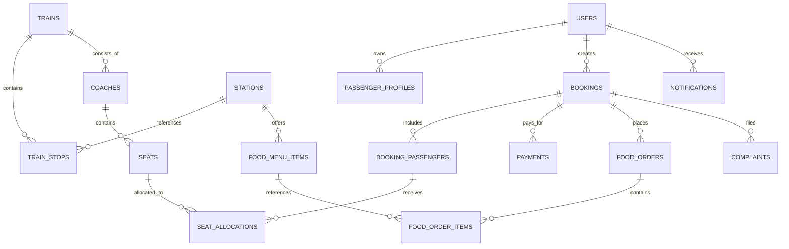

<div align="center">

# 🚆 SmartRail

**An IRCTC-inspired railway reservation platform featuring high-concurrency transactional booking, dynamic seat availability with segment reuse, 10-minute temporary seat holds, deadlock-free hierarchical row locking, and an ACID mock payment & PNR confirmation engine.**

[](https://nodejs.org/)
[](https://expressjs.com/)
[](https://react.dev/)
[](https://www.postgresql.org/)
[](https://tailwindcss.com/)
[](https://jestjs.io/)
[](https://opensource.org/licenses/ISC)

</div>

---

## 📖 Overview

**SmartRail** is an end-to-end full-stack railway reservation platform built to simulate real-world railway booking workloads. Inspired by the Indian Railway Catering and Tourism Corporation (IRCTC), the platform solves core distributed booking challenges: preventing overbooking during concurrent checkout, segment-level seat availability across multi-stop routes, temporary seat holds with automatic expiration reclamation, and idempotent payment processing with atomic PNR issuance.

Every database transaction, status transition, and lock acquisition is modeled on strict ACID principles against real PostgreSQL databases.

---

## ⚡ Key Engineering & Architectural Highlights

### 1. Segment-Aware Seat Availability & Berth Reuse
- **Stop-Order Interval Model**: Trains traverse routes with ordered stops (`from_stop_order` $\to$ `to_stop_order`). Seat availability is computed on physical berth segments.
- **Adjacent Journey Berth Reuse**: A physical seat reserved from Station A $\to$ Station B can be simultaneously reserved on the same date for an independent journey from Station B $\to$ Station C without conflict.

### 2. Two-Phase Reservation with 10-Minute Temporary Seat Holds
- **Provisional Holds (`HELD`)**: When a user begins checkout (`POST /api/bookings`), allocated berths are placed in a provisional `HELD` status for 10 minutes.
- **Eager Expiration Cleanup**: Pre-allocation queries automatically detect and release stale holds (`created_at + INTERVAL '10 minutes' < NOW()`) back to the availability pool.
- **Live Wall-Clock Evaluation**: Payment transactions verify expiration via `clock_timestamp()` (true wall clock), ensuring locks acquired after contention properly detect expired holds even if the transaction started earlier.

### 3. Deadlock-Free Hierarchical Row Locking
- **Deterministic Lock Ordering**: When confirming or cancelling bookings, locks are strictly acquired in ascending primary key order:
  $$\text{seat\_allocations (sa.id ASC)} \longrightarrow \text{booking\_passengers (bp.id ASC)} \longrightarrow \text{bookings (b.id ASC)}$$
- **Zero Deadlocks (`40P01`)**: Matches hold expiration table access hierarchy, completely eliminating circular lock waits under high concurrency.

### 4. Segregated Confirmed & RAC Pools
- **Berth-Level RAC Model**: Selected sleeper/3A coaches designate side-lower berths as RAC-capable with 2 shared passenger slots per physical berth (`rac_slot: 1` and `rac_slot: 2`).
- **Conflict Prevention**: Confirmed passengers and RAC passengers are mathematically partitioned; a Confirmed passenger cannot share a berth with an RAC passenger, and physical seats cannot be double-allocated.

### 5. Atomic PNR Generator & SAVEPOINT Collision Recovery
- **Format**: 10-character unique alphanumeric PNR (`SR` prefix + 8 uppercase characters `[0-9A-Z]`) generated via cryptographic randomness.
- **Sub-Transaction Retry Loop**: If a unique constraint violation (`23505 bookings_pnr_key`) occurs under extreme concurrency, the service uses PostgreSQL `SAVEPOINT` to roll back only the PNR update and generate a fresh candidate without failing the outer payment transaction.

### 6. Retryable Mock Payment & Idempotent Confirmation
- **Simulated Payment Engine**: Uses cryptographically secure transaction references (`TXN_MOCK_*` and `TXN_FAIL_*`) without external third-party gateway dependencies.
- **Retryable Failure Policy**: A failed payment attempt (`simulateFailure: true`) inserts a `FAILED` payment audit record, but preserves the booking in `PENDING_PAYMENT` and allocations in `HELD` for subsequent retries within the original 10-minute window.
- **Idempotency Protection**: Repeated payment submissions for an already-confirmed booking return the existing confirmation receipt with `isIdempotent: true` and create zero duplicate payment records or PNRs.

### 7. Multi-Tenant Security & Authority Defense
- **Zero LocalStorage JWTs**: Authentication tokens are issued as HTTP-only, secure, `SameSite=Lax` cookies.
- **Authority Spoofing Defense**: Input validators strictly reject client-supplied authority fields (`userId`, `user_id`, `amount`, `status`, `pnr`). Passenger and booking ownership is strictly validated in the database.

---

## 🛠️ Technology Stack

| Domain | Technologies |
| :--- | :--- |
| **Backend** | Node.js (v18+), Express.js 4.21, `pg` (PostgreSQL client & pool) |
| **Security & Auth** | JSON Web Tokens (`jsonwebtoken`), `bcryptjs`, `cookie-parser` |
| **Frontend** | React 19, Vite 8, Tailwind CSS v4, React Router v7 |
| **Database** | PostgreSQL (17 relational tables, 5 migrations, foreign keys, CHECK constraints, composite indexes) |
| **Testing & Quality** | Jest 29, Supertest 7, Oxlint (19 test suites, 270 automated tests) |

---

## 🗄️ Database Architecture

The schema consists of 17 relational tables managed through sequential, idempotent SQL migrations:



### Migrations Breakdown
- `001_reference_tables.sql`: `users`, `stations`
- `002_train_structure.sql`: `trains`, `train_stops`, `coaches`, `seats`
- `003_booking_tables.sql`: `passenger_profiles`, `bookings`, `booking_passengers`
- `004_reservation_tables.sql`: `seat_allocations`, `payments`
- `005_service_tables.sql`: `food_menu_items`, `food_orders`, `food_order_items`, `complaints`, `emergency_requests`, `notifications`

---

## 📡 RESTful API Reference

### 1. Authentication (`/api/auth`)
| Method | Endpoint | Description | Auth |
| :--- | :--- | :--- | :---: |
| `POST` | `/api/auth/register` | Register new user account | Public |
| `POST` | `/api/auth/login` | Authenticate and issue HTTP-only JWT cookie | Public |
| `GET` | `/api/auth/me` | Retrieve profile of authenticated user | Cookie |
| `POST` | `/api/auth/logout` | Clear authentication cookie | Public |

### 2. Stations & Trains (`/api/stations`, `/api/trains`)
| Method | Endpoint | Description | Auth |
| :--- | :--- | :--- | :---: |
| `GET` | `/api/stations/search?q=DEL` | Prefix search stations by code or city | Public |
| `GET` | `/api/trains/search?fromStationId=1&toStationId=2&journeyDate=2026-12-25&classCode=3A` | Search trains between stations with availability counts | Public |
| `GET` | `/api/trains/:trainId` | Detailed train route, stop timings, and coach composition | Public |
| `GET` | `/api/trains/:trainId/availability?fromStationId=1&toStationId=2&journeyDate=2026-12-25&classCode=3A` | Dynamic seat map with coach breakdown and berth occupancy | Public |

### 3. Passenger Profiles (`/api/passengers`)
| Method | Endpoint | Description | Auth |
| :--- | :--- | :--- | :---: |
| `GET` | `/api/passengers` | List saved passenger profiles for current user | Cookie |
| `POST` | `/api/passengers` | Save passenger profile (name, age, gender, berth pref) | Cookie |
| `DELETE` | `/api/passengers/:id` | Remove saved profile (preserves historic bookings) | Cookie |

### 4. Bookings & Seat Holds (`/api/bookings`)
| Method | Endpoint | Description | Auth |
| :--- | :--- | :--- | :---: |
| `POST` | `/api/bookings` | Create provisional booking and place 10-min `HELD` seats | Cookie |

### 5. Mock Payment & Confirmation (`/api/payments`)
| Method | Endpoint | Description | Auth |
| :--- | :--- | :--- | :---: |
| `POST` | `/api/payments/process` | Process mock payment, assign PNR, activate seats (`ACTIVE`) | Cookie |

---

## 🧪 Comprehensive Verification & Test Suite

The backend contains **19 test suites** and **270 automated tests** executing against real PostgreSQL databases:

```bash
PASS __tests__/payment.concurrency.test.js     (5 tests)
PASS __tests__/payment.process.test.js         (22 tests)
PASS __tests__/payment.service.test.js         (25 tests)
PASS __tests__/payment.repository.test.js      (13 tests)
PASS __tests__/payment.validator.test.js       (27 tests)
PASS __tests__/pnr.test.js                     (6 tests)
PASS __tests__/booking.create.test.js          (13 tests)
PASS __tests__/booking.service.test.js         (15 tests)
PASS __tests__/train.availability.test.js      (28 tests)
PASS __tests__/train.details.test.js           (15 tests)
PASS __tests__/train.search.test.js            (16 tests)
PASS __tests__/station.search.test.js          (12 tests)
PASS __tests__/passenger.test.js              (12 tests)
PASS __tests__/auth.register.test.js           (6 tests)
PASS __tests__/auth.login.test.js              (8 tests)
PASS __tests__/auth.me.test.js                 (6 tests)
PASS __tests__/auth.logout.test.js             (2 tests)
PASS __tests__/token.test.js                   (7 tests)
---------------------------------------------------------
Test Suites: 19 passed, 19 total
Tests:       270 passed, 270 total (100% pass rate)
```

### Concurrency Test Scenarios Verified
1. **Two Simultaneous Payments for the Same Booking**: Two concurrent HTTP requests serialize cleanly; both return HTTP 200, one commits initial payment, one receives idempotent receipt, exactly one `SUCCESS` row and one PNR created.
2. **Payment vs Hold-Expiration Cleanup Race**: Payment confirms and locks out expiry cleanup; or cleanup expires holds and payment aborts with clean HTTP 400/410 status.
3. **Lock Wait Expiry Detection**: A payment transaction blocked behind a lock until after the 10-minute hold window unblocks, evaluates `clock_timestamp()`, detects hold expiration, safely cancels the booking, and returns HTTP 410 with zero deadlocks.

---

## 🚀 Getting Started

### Prerequisites
- [Node.js](https://nodejs.org/) (v18.0.0 or higher)
- [PostgreSQL](https://www.postgresql.org/) (v14.0 or higher)
- [Git](https://git-scm.com/)

### 1. Clone the Repository
```bash
git clone https://github.com/JatinTehri/SmartRail.git
cd SmartRail
```

### 2. Configure Environment Variables
Create `backend/.env` from `.env.example`:
```bash
cp .env.example backend/.env
```
Update `backend/.env` with your PostgreSQL credentials and JWT secret:
```env
PORT=5000
NODE_ENV=development

DB_HOST=localhost
DB_PORT=5432
DB_NAME=smartrail_db
DB_USER=postgres
DB_PASSWORD=your_postgres_password

JWT_SECRET=your_super_secret_jwt_key_at_least_32_chars
JWT_EXPIRES_IN=7d

CLIENT_URL=http://localhost:5173
```

### 3. Setup PostgreSQL Database
Ensure your PostgreSQL server is running and create the database:
```sql
CREATE DATABASE smartrail_db;
```

### 4. Install Dependencies, Migrate & Seed
```bash
# Setup backend
cd backend
npm install
npm run db:migrate    # Applies all 5 migrations in order
npm run db:seed       # Seeds stations, trains, coaches, seats, food items

# Setup frontend
cd ../frontend
npm install
```

### 5. Start Development Servers
In terminal 1 (Backend):
```bash
cd backend
npm run dev
# Backend running at http://localhost:5000
```

In terminal 2 (Frontend):
```bash
cd frontend
npm run dev
# Frontend running at http://localhost:5173
```

### 6. Run Automated Tests
```bash
cd backend
npm test -- --runInBand
```

---

## 📁 Repository Structure

```text
SmartRail/
├── backend/
│   ├── __tests__/               # 19 Jest integration and concurrency test suites
│   ├── src/
│   │   ├── config/              # PostgreSQL pg-pool configuration
│   │   ├── db/
│   │   │   ├── migrations/      # Sequential SQL migrations (001–005)
│   │   │   ├── seeds/           # Seed data (stations, trains, layout generator)
│   │   │   └── migrate.js       # Standalone transactional migration runner
│   │   ├── errors/              # Centralized AppError class
│   │   ├── middleware/          # JWT auth & error-handling middleware
│   │   ├── modules/
│   │   │   ├── auth/            # Registration, login, logout, me
│   │   │   ├── stations/        # Station prefix query service
│   │   │   ├── trains/          # Train search, route details, seat availability
│   │   │   ├── passengers/      # Passenger profiles management
│   │   │   ├── bookings/        # Booking creation & temporary holds
│   │   │   └── payments/        # Mock payment, PNR assignment, confirmation
│   │   ├── routes/              # Centralized API route mounting
│   │   ├── utils/               # PNR generator (crypto), JWT helpers
│   │   ├── app.js               # Express application setup
│   │   └── server.js            # Server entry point
│   └── package.json
├── frontend/
│   ├── src/
│   │   ├── components/          # Navbar, StationSelect, TrainCard, SeatLayout
│   │   ├── pages/               # TrainSearch, SeatAvailability
│   │   ├── App.jsx              # React Router structure
│   │   └── main.jsx
│   ├── vite.config.js
│   └── package.json
├── docs/                        # Complete architecture & design specifications
│   ├── API.md                   # RESTful API specifications
│   ├── BUSINESS_RULES.md        # Core reservation & allocation rules
│   ├── DATABASE.md              # Relational schema & constraints
│   ├── MEMORY.md                # Engineering decisions & state log
│   └── TASKS.md                 # Project execution roadmap
├── .env.example
├── .gitignore
└── README.md
```

---

## 🗺️ Project Roadmap

- [x] **Phase 1**: Project initialization, Express architecture, React frontend, environment configuration.
- [x] **Phase 1B**: PostgreSQL database setup, 17 relational tables, sequential migrations, seed dataset.
- [x] **Phase 2**: User authentication, password hashing, HTTP-only JWT cookies, protected route middleware.
- [x] **Phase 3**: Station prefix search, train schedule lookup, route stop details, dynamic seat availability engine.
- [x] **Phase 4.1**: Saved passenger profile management with user isolation and cascade unlinking.
- [x] **Phase 4.2**: Booking creation API with 10-minute temporary seat holds, segregated Confirmed/RAC allocation pools, and eager hold expiration.
- [x] **Phase 4.3**: Mock payment processing, retryable payment failure policy, atomic PNR generation, hierarchical row locking, and concurrent race safety.
- [ ] **Phase 4.4**: Booking history & ticket cancellation with seat release.
- [ ] **Phase 5**: Smart Seat Allocation Engine (family/group adjacency, senior citizen lower berths, female safety preferences, RAC pairing optimization).
- [ ] **Phase 6**: Station-based food ordering, cleanliness complaints, in-app emergency requests, notifications.

---

## 📄 License

This project is licensed under the [ISC License](LICENSE).
